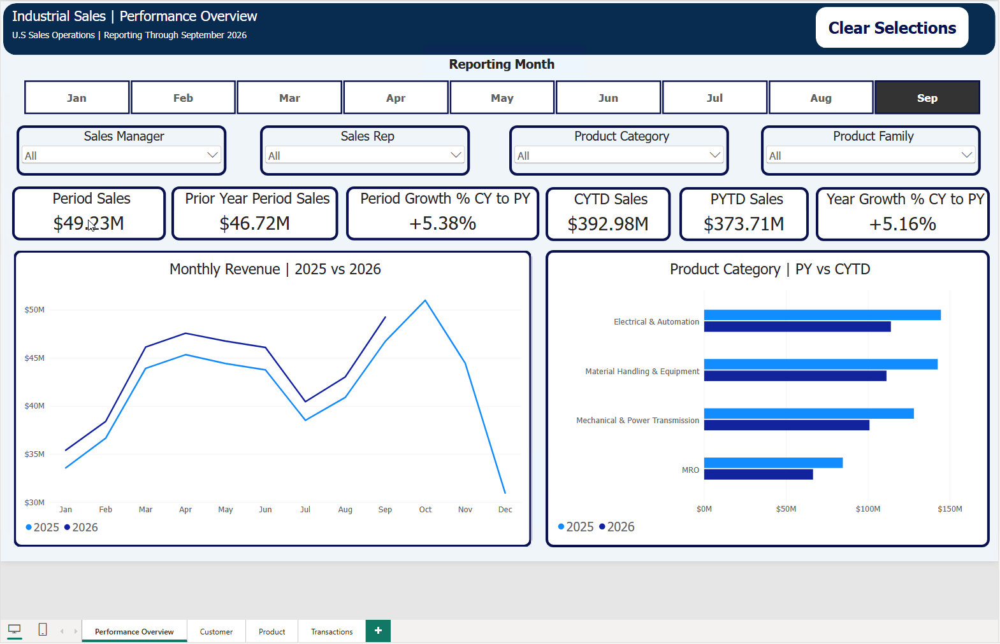
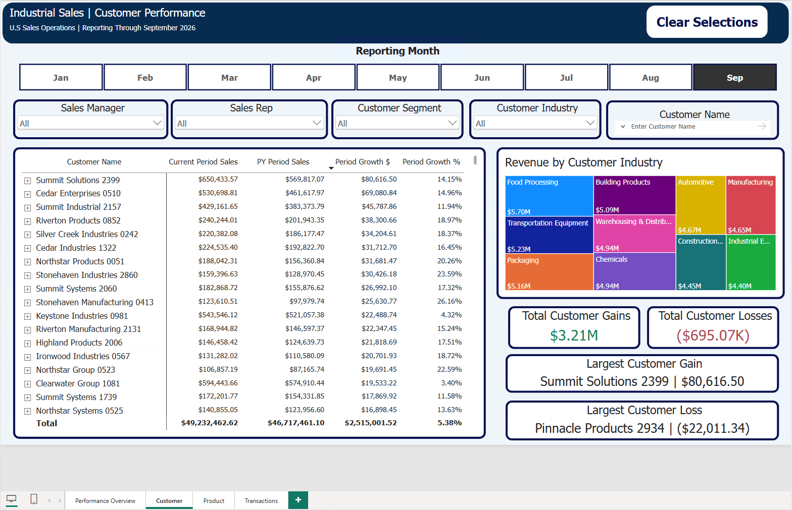
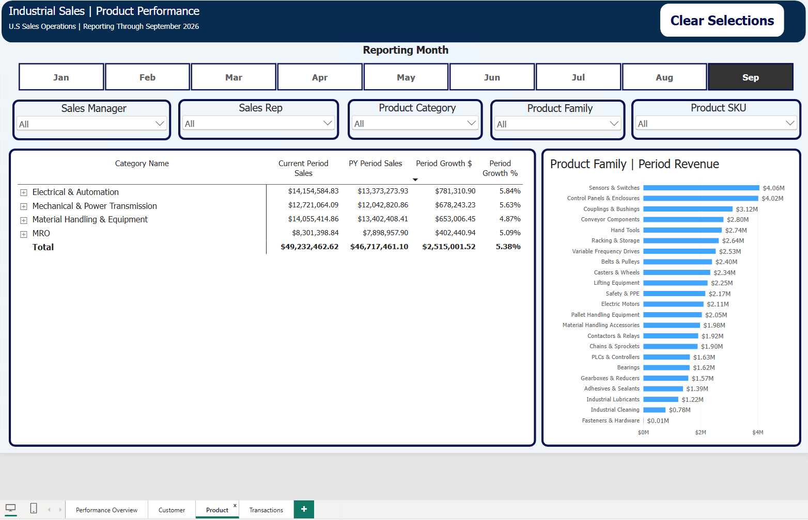
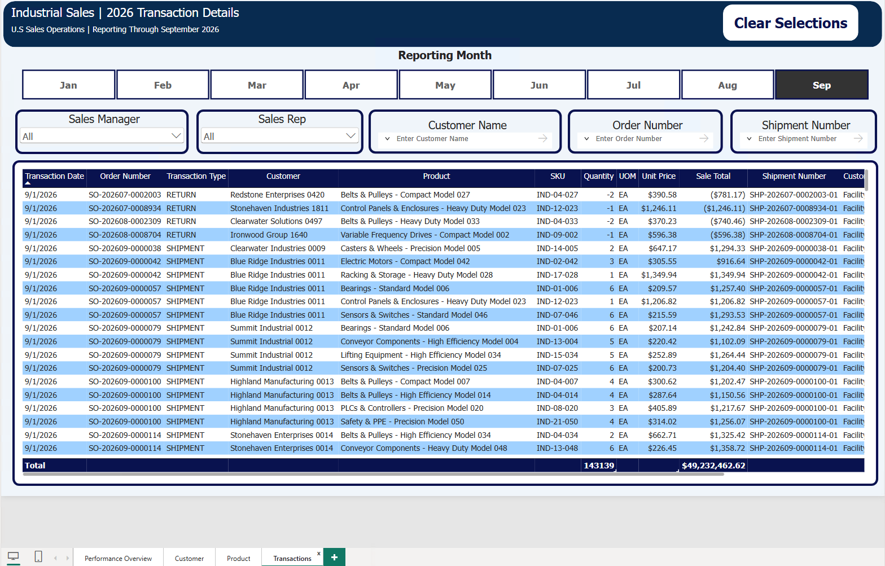

# Industrial Sales Operations Analytics

**Synthetic industrial distribution data | Python | PostgreSQL | Power BI**

An end-to-end portfolio project that models sales operations for a fictional U.S. industrial distributor. The project generates synthetic ERP-style sales transactions, validates and loads them into PostgreSQL, assigns sales coverage by ZIP code, and presents revenue, customer, product, and transaction-level analysis in a four-page Power BI report.

All customers, representatives, sales transactions, and other business records in the project are synthetic. Geographic enrichment uses separate public reference datasets described under [Data sources and reproducibility](#data-sources-and-reproducibility).

## Project at a glance

| Metric | Scope represented in the completed report |
|---|---:|
| Transactions | 810,340 |
| Net sales | $893,073,890.05 |
| 2025 transactions | 453,945 |
| 2025 net sales | $500,092,428.09 |
| January–September 2026 transactions | 356,395 |
| January–September 2026 net sales | $392,981,461.96 |
| Customers | 3,000 |
| Customer ship-to facilities | 5,000 |
| Product SKUs | 1,200 |
| Sales representatives | 84 |

The figures above describe the validated project dataset and report, not real commercial activity. Net sales include the effects of returns.

## Power BI report

The completed report contains four pages. Each page has its own slicer selections and a **Clear Selections** control. Month selections on the three analytical pages support period comparisons; the Transaction Details page is a separate research experience restricted to 2026 data.

### 1. Performance Overview

Displays selected-period sales and prior-year comparisons, current-year-to-date and prior-year-to-date indicators, monthly revenue trends, and product-category revenue comparisons.



### 2. Customer Performance

Supports customer and ship-to facility analysis, selected-period growth and decline comparisons, revenue by customer industry, and customer gain/loss summaries.



### 3. Product Performance

Provides product category, family, product, and SKU analysis alongside product-family revenue rankings.



### 4. 2026 Transaction Details

Provides a current-year transaction lookup with sales manager and representative selectors, reporting-month selection, and text search for customer names, order numbers, and shipment numbers. Transaction rows include dates, shipment/return type, product details, quantities, and sales amounts.



> The screenshots represent the completed local Power BI Desktop report. A publicly hosted interactive report link will be added only after a separate review and publication step.

## Data architecture

```text
Synthetic master data + generated ERP-style transactions
                      |
                      v
               Python validation
                      |
                      v
             PostgreSQL staging
                      |
                      v
          PostgreSQL core business tables
          + ZIP-based sales assignments
                      |
                      v
       PostgreSQL analytics views/dimensions
                      |
                      v
        Python export to six Parquet files
                      |
                      v
                Power BI Desktop
```

### Python generation and ETL

The source in `src/generation/` constructs the fictional customer and ship-to master data, product catalog, pricing, purchasing profiles, shipments, returns, ZIP reference enrichments, and ZIP-to-representative assignments. `src/etl/` includes consolidation, validation, database loading, and reporting-export scripts.

The generation and ETL scripts contain data-quality checks and fixed expected totals for this dataset. They should not be treated as general-purpose importers for unrelated ERP exports without adaptation.

### PostgreSQL layers

- **`staging`**: Raw ERP-style transaction ingestion and validation.
- **`core`**: Customers, ship-to facilities, products, prices, sales transactions, ZIP references, sales assignments, and the fictional sales organization.
- **`analytics`**: Reporting fact/dimension views and sales, customer, product, and territory-performance aggregations.

The report's exported model uses the `fact_sales_transactions`, `dim_date`, `dim_customer`, `dim_ship_to`, `dim_product`, and `dim_sales_rep` datasets. The Power BI report also contains calculations and a report-month selection table built within Power BI.

## ZIP-based sales coverage

The project uses customer ship-to ZIP codes to attribute sales to synthetic Field and Inside sales representatives. The assignment process uses geographic and sales-coverage inputs with documented planning assumptions.

**This is sales-attribution territory assignment, not a claim of optimized driving routes or real-world territory deployment.** The reporting model applies the current ZIP ownership structure to both sales years for comparison.

Relevant implementation: `src/generation/build_zip_territory_assignments.py`, `sql/core/07_create_zip_rep_assignment.sql`, and `sql/core/08_create_sales_organization.sql`.

## Validation and reconciliation

The repository contains checks for source-file structure, transaction relationships, return references, quantities and prices, row counts, and net sales. Reporting views and the Power BI export script also include reconciliation checks.

For the completed dataset, reported totals reconcile to:

- **2025:** 453,945 transactions and $500,092,428.09 net sales.
- **January–September 2026:** 356,395 transactions and $392,981,461.96 net sales.
- **Combined:** 810,340 transactions and $893,073,890.05 net sales.

A geographic-source validation record is available in docs/validation/2026_census_zcta_validation.md. It documents the structural validation results and geographic limitations of the Census reference data used during development.

## Technology

- **Python:** Synthetic generation, data preparation, validation, loading, and Parquet export
- **PostgreSQL 18 / SQL:** Staging, core data model, reporting views, and reconciliations
- **pandas, NumPy, scikit-learn:** Data generation and geographic assignment processing
- **psycopg, SQLAlchemy, PyArrow:** Database access and reporting-data export
- **Power BI Desktop / DAX:** Semantic model, measures, analysis, and interactive report
- **Development environment:** Fedora Linux, VS Code, DBeaver; Power BI Desktop on a Windows virtual machine

## Repository contents

```text
.
├── README.md
├── requirements.txt
├── .gitignore
├── src/
│   ├── generation/
│   └── etl/
├── sql/
│   ├── 00_create_schemas.sql
│   ├── staging/
│   ├── core/
│   └── analytics/
├── docs/
│   └── validation/
├── powerbi/
│   └── Industrial_Sales_Operations_Analytics.pbix
└── screenshots/
    ├── 01-performance-overview.png
    ├── 02-customer-performance.png
    ├── 03-product-performance.png
    └── 04-transaction-details.png
```

Generated datasets, local configuration, database contents, and Parquet extracts are excluded from the public source repository. The completed Power BI Desktop `.pbix` file is included so reviewers can open and explore the report and inspect its model and measures.

## Data sources and reproducibility

**What this repository provides:** Python scripts for synthetic data generation and ETL, SQL schema and reporting definitions, dependency specifications, validation logic, report screenshots, and the completed Power BI Desktop `.pbix` source file with its imported synthetic report data.

**What it does not provide:** A prepopulated PostgreSQL database, standalone generated CSV/Parquet datasets, or the external reference archives used during geographic-data preparation. The included `.pbix` can be explored with Power BI Desktop, but refreshing it requires access to the corresponding Parquet exports and updating its machine-specific source paths.

The ZIP-reference preparation code expects separately acquired reference inputs, including U.S. Census geography and ZIP-related reference data. The project source references the applicable local archive filenames under `data/reference/`; those files must be obtained separately and their redistribution terms reviewed by anyone reproducing the project.

The database-loading and export scripts assume a locally configured PostgreSQL instance, including the `industrial_sales_ops_analytics` database and applicable authentication. Some scripts use local connection defaults. Script execution order, reference-data acquisition, and an end-to-end clean-environment rebuild have **not yet been packaged or verified as a single automated setup procedure**. For that reason, this repository is presented as an inspectable implementation rather than a verified one-command installation.

Useful entry points for reading the workflow:

- `src/generation/` — Synthetic masters, sales profiles, transactions, and sales-coverage assignments
- `src/etl/` — Consolidation, staging loads, dimension/master loads, and Parquet export
- `sql/staging/` — Staging schema and transaction validation
- `sql/core/` — Business entities, loaded transactions, and assignment tables
- `sql/analytics/` — Fact and dimension reporting views and analytical summaries
- `src/etl/export_powerbi.py` — Validates the PostgreSQL reporting source and writes the six Power BI Parquet datasets

## Project boundaries

This is a demonstration of data preparation, modeling, reconciliation, and business reporting using fictional sales operations data. It is not a live operational system, a production security implementation, or a general-purpose ERP product.
